# FrameLoad 🚀

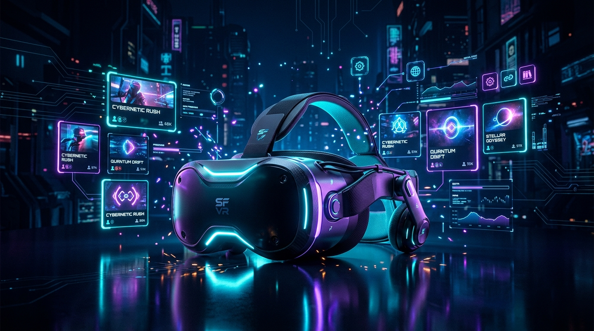

**Install, port, play and manage Android VR games and apps on the Steam Frame, from inside the headset.**

[](https://github.com/Crypto90/frameload)
[](https://github.com/Crypto90/frameload/releases)
[](https://github.com/Crypto90/frameload/actions)
[](#)
[](LICENSE)
[](https://ko-fi.com/K3K314GUP?ref=frameload_readme)

---

FrameLoad runs on the Steam Frame itself (SteamOS on ARM64), so no PC is needed. It:
- installs Android apps into Valve's Lepton container, the Frame's own Android runtime;
- ports games built for Meta's Quest runtime with [FramePort](https://github.com/spoopyghosty0/frameport);
- adds everything to your Steam library with artwork;
- watches storage, memory and play time.

Its dashboard is built for the controller's laser pointer in the headset. You can also open it from a phone or PC on the same Wi-Fi.

**Contents:** [Looks](#-six-looks) · [Features](#-features) · [Install](#-install) · [Opening FrameLoad](#-opening-frameload) · [Updating](#-updating) · [Uninstalling](#-uninstalling) · [Guide](#-guide) · [Controls](#-controls) · [Command line](#-command-line) · [Files and folders](#-files-and-folders) · [Configuration](#-configuration) · [Support](#-support-the-project)

---

## 🎨 Six Looks

FrameLoad comes in six looks. Pick one under **System → Appearance**. It changes at once and is remembered on the headset. **Big Picture** is the default. Each look arranges the library its own way, and every other screen follows its colours and type.

| A · Big Picture (default) | B · Spatial |
|:---:|:---:|
| [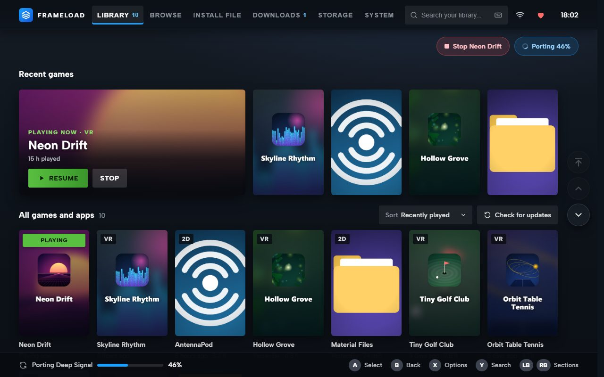](docs/images/looks/look-a.jpg) | [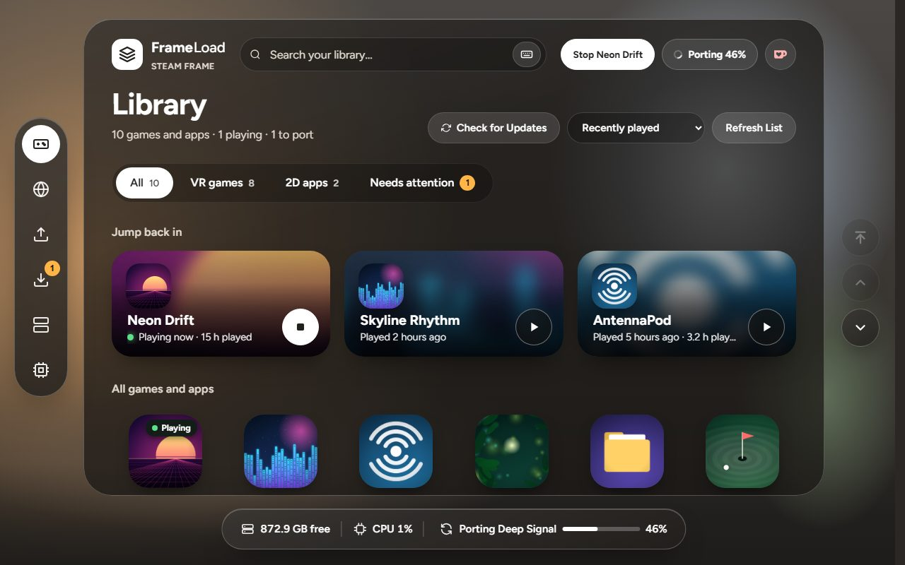](docs/images/looks/look-b.jpg) |
| *Looks like SteamOS: tabs on top, Steam covers, the controller's buttons along the bottom* | *A floating glass window with the navigation beside it; the largest targets* |

| C · Showcase | D · Neon |
|:---:|:---:|
| [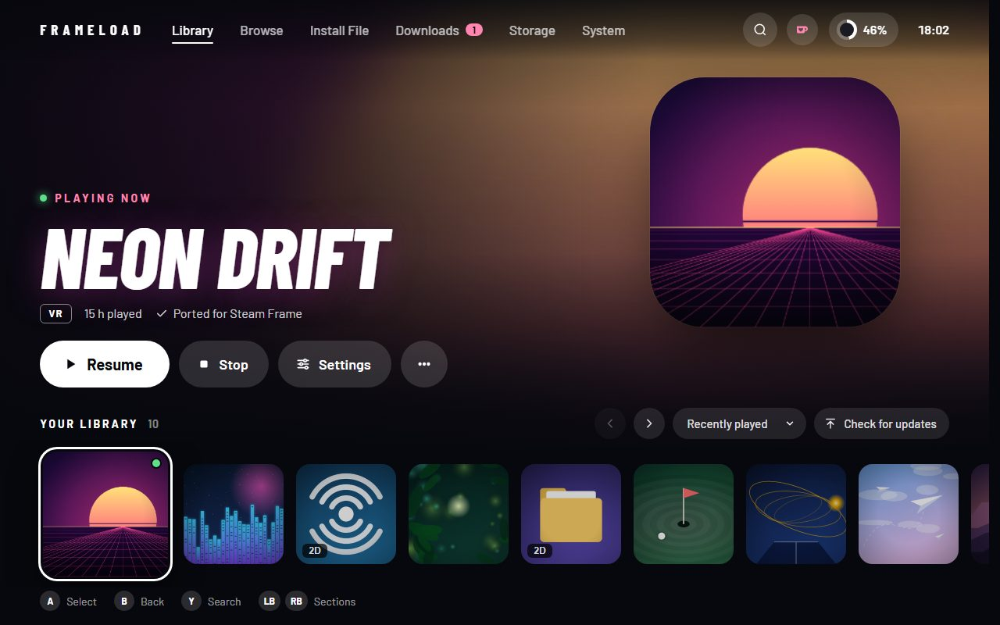](docs/images/looks/look-c.jpg) | [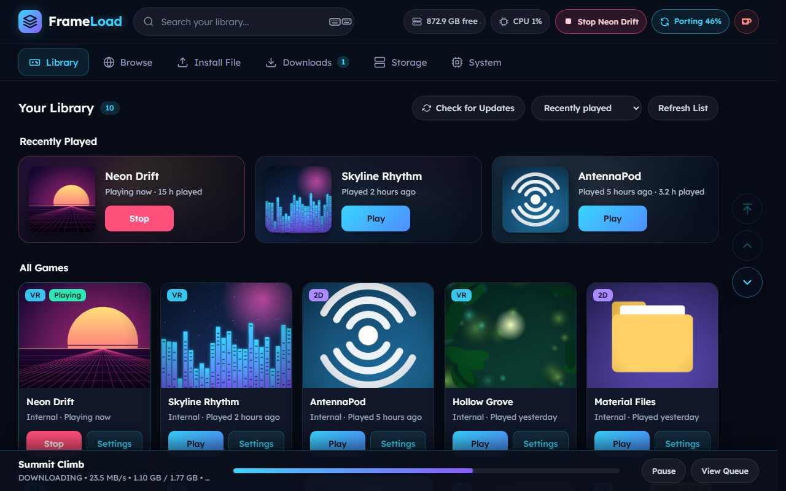](docs/images/looks/look-d.jpg) |
| *Your last game fills the screen with one big Play button; the library sits in one row* | *The original FrameLoad look, refined* |

| E · Command Center | F · Daylight |
|:---:|:---:|
| [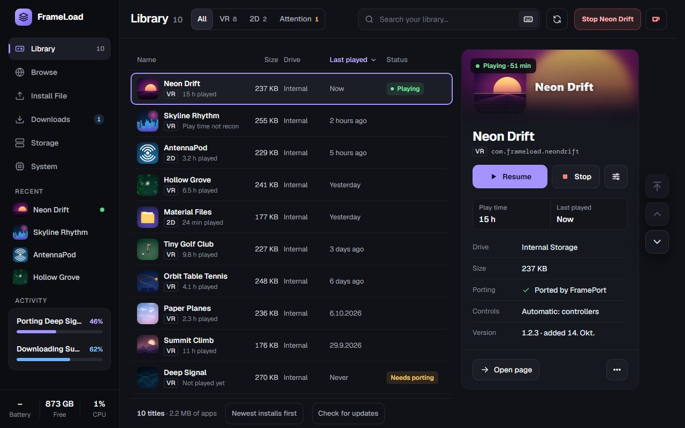](docs/images/looks/look-e.jpg) | [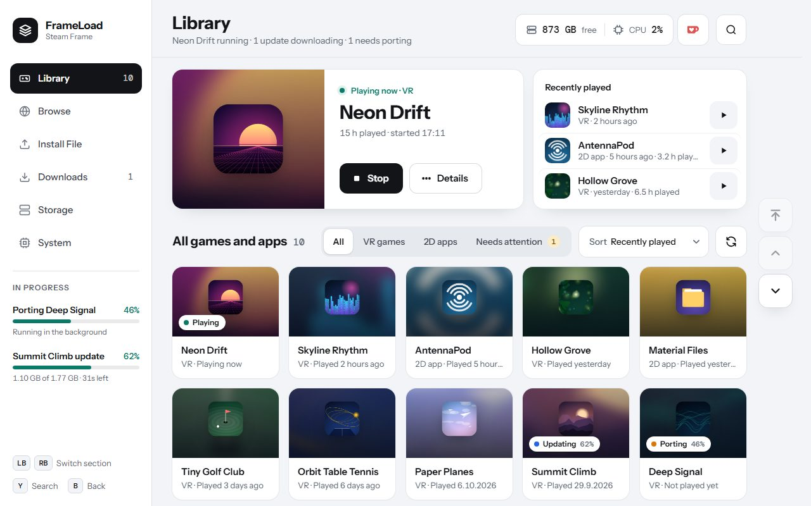](docs/images/looks/look-f.jpg) |
| *A sortable list beside a detail panel, for big libraries and managing them* | *Calm and very legible, in a light and a [dark](docs/images/looks/look-f-dark.jpg) version* |

The fonts of the looks are bundled with FrameLoad (SIL Open Font License, see `frameload/web/static/fonts/OFL.txt`), so they work without a network. Game titles and covers in these pictures are examples.

---

## ⚡ Features

### 📚 Library
- All your games and apps in one place. The library starts with the games you played last (**Recent games** in Big Picture), with when you last played and for how long. Each game's launcher records its sessions, so games started from Steam count too.
- Sort by recently played, name, install date or size. Search filters as you type.
- A game's page has **Launch in VR** (**Open** for a 2D app), **Settings**, **Launch Log**, **Backup Saves** and **Uninstall**.
- A running game gets a **Stop** button, plus a Stop chip that stays on screen while it runs.
- A Quest game that still needs porting shows **Port & Play**: it is ported first and starts by itself when that is done.

### 📥 Installing apps
- **Install File:** install an APK, an XAPK, APKS or ZIP bundle, or an extracted game folder.
  - The built-in file browser covers Home, Downloads, the microSD card and USB drives, so you never type a path on a VR keyboard.
  - OBB files beside the APK are installed with it: loose `main.` / `patch.<version>.<package>.obb` files, or a folder named after the package.
- **Upload from a phone or PC:** open the dashboard on a paired device and choose the APK and its OBB files. They are sent to the headset and inspected, and **Install and Add to Steam Library** installs them.
- **Compatibility check before you install:** FrameLoad reads the APK's binary manifest and its native libraries and gives one of four verdicts:

  | Verdict | When |
  | :--- | :--- |
  | *Ready for Steam Frame* | Ported with FramePort, or a 2D app |
  | *Should run* | Native OpenXR |
  | *Needs porting first* | Built for Meta's runtime, or no launcher activity |
  | *Cannot run* | 32-bit only, needs a newer Android than Lepton's (Android 14), delivered as split APKs, or checks its own signature |
- **Browse** has two catalogs:
  - VR games from the catalog mirror set under System → Mirror Manager
  - free Android apps from F-Droid

  Downloads can be paused, resume after an interruption and install by themselves when they finish. The Downloads tab shows each one with its picture, its state (Downloading, Unpacking, Installing, Installed, Failed) and the time left.
- **F-Droid store:**
  - Lists only apps Lepton can run: 64-bit ARM, Android 14 or older.
  - Offers F-Droid's suggested version and checks every download against the catalog's SHA-256 before installing.
  - Each app's page shows its screenshots, and its trailer where it has one.
  - **Update N Apps** appears when installed apps have newer versions.
  - Apps open as a flat window with Android's navigation bar hidden.
- **Install links:** `frameload://install?url=…` (an https link to an `.apk`), `frameload://sideload?path=…` and `frameload://launch?package=…`. A link never installs anything by itself: the dashboard shows where it comes from and waits for you to press **Install**, and a Quest game installed that way is ported like any other install. A launch link does what **Play** does: it starts the game right away, ports a game built for Meta's runtime first, and refuses an app that cannot run on the Frame.

### 🔧 Quest games, ported on the headset
- Games built for Meta's Quest runtime are converted for the Frame on the headset with [FramePort](https://github.com/spoopyghosty0/frameport): OVRPort conversion, the FrameBridge adapter, and signing.
- FrameLoad does the setup and upkeep for you:
  - downloads FramePort and its tools by itself and keeps FramePort current;
  - ports a game right after it is installed;
  - keeps the original APK, so the game can be ported again.
- A progress bar shows the step the port is on. A port keeps running in the background, with its percentage in the dashboard. See [Porting a Quest game](#porting-a-quest-game).

### 🥽 Per-game settings
- **Every Android app, ported or not:** foveated rendering (follow gaze, fixed or off) and typing for VR apps, the navigation bar for 2D apps.
- **Games ported with FramePort:** hand input, resolution scale, refresh rate (72-144 Hz), vibration strength, space warp and play space, with the presets *Sharper*, *120 Hz* and *Battery saver*.
- Only settings the headset actually reads are offered. Defaults for all games are under System → Default Game Settings. Details are in the [settings guide](#per-game-settings).

### 🎮 Steam library
- **Artwork:** every install becomes a non-Steam game with a poster, banner, hero image, logo and icon.
  - The icon is the app's own launcher icon from its APK. A downloaded cover stands in for apps without a complete icon of their own.
  - A downloaded cover is used for the poster where there is one.
  - The dashboard draws whatever is still missing from the icon, the cover and the title.
- **New games:** Steam loads new shortcuts only when it starts. FrameLoad shows which games are waiting, starts them itself in the meantime, and offers **Restart Steam Now**.
- **Steam's menu:** Steam opens its Resume / Exit menu over a game that has just started. When a ported game shows its first frame, its launcher closes that menu.

### 💾 Storage: internal, microSD and USB
- **Only real drives are listed:** the internal storage, a microSD card and USB drives. Drives are classified by the bus the kernel reports, so the Frame's own system partitions never appear.
- **FAT, exFAT and NTFS:** cards in these formats are shown but cannot hold games. Lepton needs a Linux filesystem such as ext4.
- **Choosing a drive:** with more than one drive that can hold games, installing from Browse asks where to put the game, like Steam does. It can remember your choice as the default.
- **Moving games:** **Move Drive** on a game's page asks which drive to move it to and shows each drive's free space against the game's size. The copy is checked before the original is removed.
- **The Storage tab** shows each drive's space split into games, saves, shaders and other, and lists every game's size. You can select several games to move or uninstall them, clean the download cache, or reset the shader caches of the installed games on every drive.

### 🧊 Freeze Guard, Keep Awake and Performance
- **Freeze Guard:** a game that uses up the headset's memory freezes everything, even the Steam button. FrameLoad prevents that:
  - It limits each game's memory so SteamVR keeps 2.5 GB.
  - It watches memory pressure while a game runs, ends the game before the headset locks up, and tells you which game it was.
- **Keep Awake:** FrameLoad holds SteamOS's sleep inhibitor while it downloads from Browse, installs a game (a download, a file from the Install File tab or one sent from your phone or PC) or ports a game. You can also keep the headset awake for an hour, or until you switch it off. Whether Steam's own sleep timer on the Frame honours the inhibitor is not confirmed yet.
- **Performance:** System → Performance shows CPU, memory, swap, GPU clock and temperatures live. Neon, Spatial, Command Center and Daylight also show CPU use in their status area.

### 📱 Phone & PC access
- Open `http://<headset-ip>:5050` on another device on the same network. Pair it once with a six-digit code shown in the headset, and it can browse, install and upload like the headset can.

### 🧩 Saves, mods and logs
- **Save backups** hold the app's private storage, where most games save, and its shared storage. Uninstalling a game in the dashboard makes a backup first; if the backup fails, the game stays installed until you choose to uninstall it without one.
- **Mods and Beat Saber custom songs** go into the game's shared storage from its page or the command line.
- **Launch Log** explains the usual reasons a game does not start, in plain words.
- **Self-test:** checks everything FrameLoad relies on. It runs by itself when the dashboard opens and only speaks up when something is wrong.

### ⚡ Updates
- **In-headset updates:** FrameLoad tells you when a new version is out and updates itself with one press in the headset. Release downloads are checked against the release's `SHA256SUMS`.

### 🪟 Windows and 🐧 Linux apps (experimental)
- A Windows `.exe` or a Linux AppImage / ELF binary gets a launcher and a Steam shortcut.
  - The `.exe` runs with a Proton from your Steam libraries, or Wine.
- These launchers have not been verified on a Steam Frame yet.
- Per-game settings, the Freeze Guard and Stop do not cover them.

| Porting on the headset | Choosing the drive |
|:---:|:---:|
| [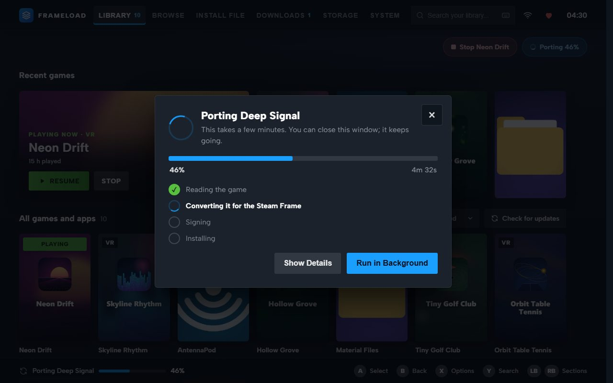](docs/images/features/porting.jpg) | [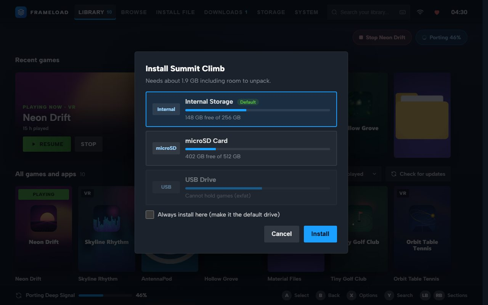](docs/images/features/install-drive.jpg) |
| **Per-game settings** | **Downloads** |
| [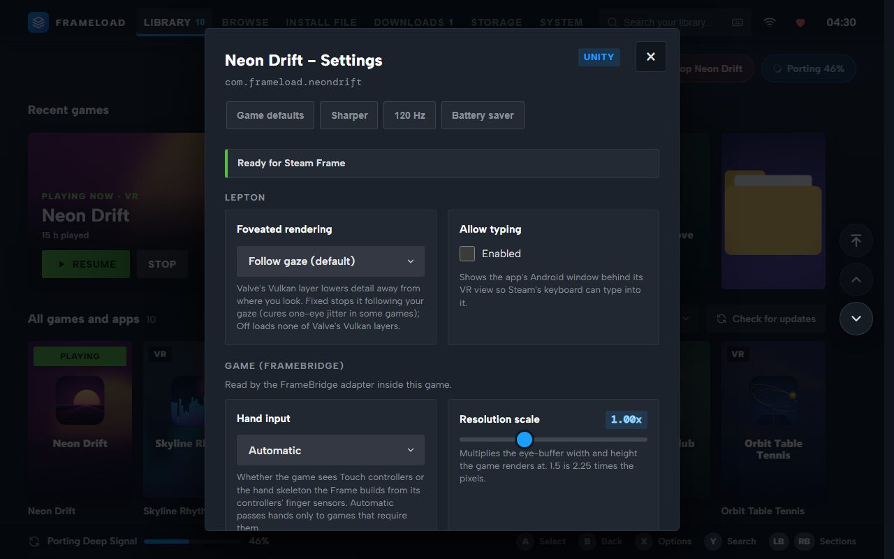](docs/images/features/settings.jpg) | [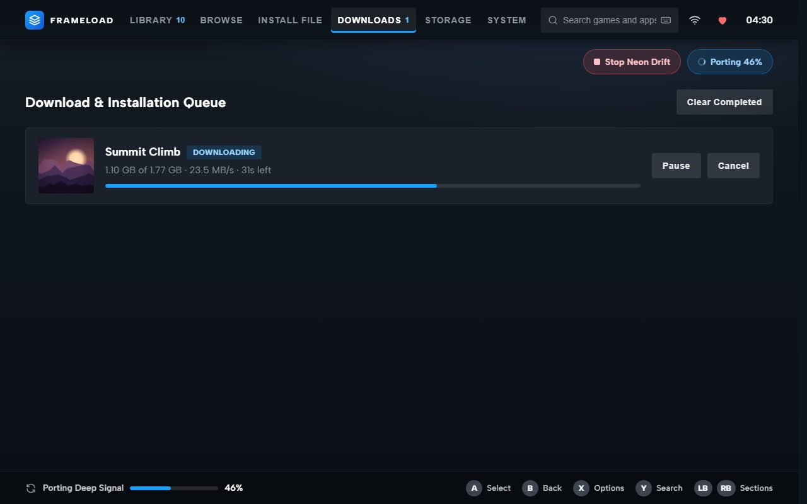](docs/images/features/downloads.jpg) |

*Big Picture look with example games and drives.*

> [!NOTE]
> Only install games and apps you own or are otherwise allowed to use.

---

## 🚀 Install

On the Steam Frame, open a terminal (Konsole in Desktop Mode, or SSH) and run:

```bash
curl -fsSL https://raw.githubusercontent.com/Crypto90/frameload/main/install.sh | bash
```

This puts FrameLoad in `~/Applications/FrameLoad` and sets it up. It makes a git checkout when git is available, and otherwise downloads the latest release. Run it as your normal user, not with `sudo`.

**Or with the release installer.** It needs no git. Run it as a file, not through a pipe:

```bash
curl -fsSLO https://github.com/Crypto90/frameload/releases/latest/download/frameload-installer.sh
bash frameload-installer.sh
```

**Or from a git clone:**

```bash
git clone https://github.com/Crypto90/frameload.git ~/Applications/FrameLoad
bash ~/Applications/FrameLoad/install.sh
```

To install somewhere else, give the folder to `bash`: `curl -fsSL https://raw.githubusercontent.com/Crypto90/frameload/main/install.sh | FRAMELOAD_INSTALL_DIR=<folder> bash`, or `FRAMELOAD_INSTALL_DIR=<folder> bash frameload-installer.sh`. See [Uninstalling](#-uninstalling) for removing such an install.

### What the installer sets up

1. `keyring = false` in `~/.config/containers/containers.conf`. Without it, rootless podman runs out of kernel keyrings after about 200 game starts.
2. A static 7-Zip in `~/.local/share/frameload/bin/` when none is installed. It unpacks XAPK, APKS and ZIP bundles.
3. The desktop entry, which also opens `frameload://` links, and the `frameload` command in `~/.local/bin`.
4. The background service `frameload.service` (a systemd user service on port 5050). Where the user's systemd cannot be reached, an autostart entry starts it instead.
5. **FrameLoad** in your Steam library, with its artwork. If Steam was running, restart it (or switch to Gaming Mode) to see it.

Lepton comes with the Steam Frame; FrameLoad only looks for it. FrameLoad downloads the porting tools by itself later (see [Porting a Quest game](#porting-a-quest-game)).

---

## 🥽 Opening FrameLoad

- **In the headset or Gaming Mode:** select **FrameLoad** in your Steam library.
- **In Desktop Mode:** application launcher → Games → **FrameLoad**, or run `frameload` in a terminal.
- **In a browser on the headset:** `http://localhost:5050`.
- **From a phone, tablet or PC** on the same network: `http://<headset-ip>:5050`. The first time, that device shows a pairing page. In the headset, open **System → Phone & PC Access → Show Pairing Code** and type the six digits on the device.

FrameLoad opens exactly one window, and closing that window closes it. The service keeps running in the background. The window is the first of these that is available:
1. a native window, if Qt WebEngine or WebKit2GTK is installed
2. Chrome or Chromium in app mode
3. Firefox with a profile of its own (full screen in Gaming Mode)
4. the default browser (closing it does not end FrameLoad in Steam; use Steam's Exit)

Starting FrameLoad again while its window is open does not open a second one.

---

## 🔄 Updating

FrameLoad checks GitHub at most every six hours; **Check for Updates** under System → FrameLoad Updates checks right away. When a new version is out, an **Update** chip appears in the header and a banner on top.

To install it, press **Review & Update** in the banner (or the **Update** chip) and then **Update and Restart**, or press **Update Now** under System → FrameLoad Updates. FrameLoad updates itself and restarts its service, and the page reloads.

- **A git install** updates with `git pull` from `main`, so it also gets fixes between releases. If files you changed in the FrameLoad folder are in the way, the update stops and names them; nothing is stashed or overwritten, and nothing restarts.
- **A release install** downloads the new release archive and checks it against the release's `SHA256SUMS`. If it does not match, nothing is changed.

---

## 🧹 Uninstalling

**In the headset:** go to System → **Clean Uninstallation** → **Uninstall FrameLoad...**.
1. Choose whether to delete the installed games too (off by default) and whether to keep the save backups (on by default).
2. Type `UNINSTALL` and confirm.

**From a terminal:**

```bash
curl -fsSL https://raw.githubusercontent.com/Crypto90/frameload/main/uninstall.sh | bash
```

It asks the same questions. To answer them on the command line instead, pass options like this: `curl -fsSL https://raw.githubusercontent.com/Crypto90/frameload/main/uninstall.sh | bash -s -- --yes`.

| Option | Effect |
| :--- | :--- |
| `-y`, `--yes` | Do not ask; keep games and save backups unless the options below say otherwise |
| `--purge-games` | Also delete every installed game (internal storage, microSD card, USB drives) |
| `--purge-backups` | Also delete the save backups |
| `--purge-all` | Same as `--yes --purge-games --purge-backups` |

`bash uninstall.sh` in the FrameLoad folder does the same. `frameload uninstall-app [--yes] [--purge-games] [--purge-backups]` asks only one y/N question (none with `--yes`): games and save backups are kept unless you pass the options.

If you installed into another folder, run `curl -fsSL https://raw.githubusercontent.com/Crypto90/frameload/main/uninstall.sh | FRAMELOAD_INSTALL_DIR=<folder> bash`, then delete that folder yourself.

**What is removed:**
- the service, the desktop entry and the `frameload` command
- FrameLoad's own Steam shortcut and its artwork
- `~/.local/share/frameload` (except the save backups, when kept)
- the browser profile of FrameLoad's window
- `~/Applications/FrameLoad`

Installed games and their Steam shortcuts stay unless you choose to delete the games. When you delete them and keep the save backups, a game whose saves cannot be backed up stays installed; `uninstall.sh` and `frameload uninstall-app` name it. While Steam is running it keeps its own copy of the shortcut list and can write FrameLoad's entry back when it exits; if FrameLoad is still in your library after a Steam restart, remove it there (Manage → Remove non-Steam game).

The signing keys of ported games are always copied to `~/Documents/FrameLoad-signing-keys` first. An update of a ported game must be signed with the same key, and FrameLoad's next porting setup imports the keys again.

---

## 📖 Guide

### Per-game settings

Open a game in the **Library** and press **Settings**. Every control maps to something the headset reads. **System → Default Game Settings → Edit Defaults** sets the values every game starts from. When you save a game's Settings, the game keeps as its own only the values you set differently from those defaults; every other setting goes on following them, so a later change of the defaults still reaches it. Setting a value back to the default makes it follow the defaults again.

**For every Android app (Lepton)**

| Setting | What it does | How |
| :--- | :--- | :--- |
| Foveated rendering (VR) | *Follow gaze* (default), *Fixed* (cures one-eye jitter in some games) or *Off* | `FDM_DEBUG=disable_offsets` / `VK_INSTANCE_LAYERS=""` for `lepton start` |
| Allow typing (VR) | Shows the app's Android window behind its VR view, so Steam's keyboard reaches it | `lepton-show-flatscreen` marker |
| Hide Android navigation bar (2D, on by default) | Removes Android's back / home / recents bar | `qemu.hw.mainkeys=1` boot property |

**For games ported with FramePort (FrameBridge adapter)**

| Setting | Values | FrameBridge key |
| :--- | :--- | :--- |
| Hand input | Automatic, Controllers, Hands | `controller_fix` |
| Resolution scale | 0.5x - 2.0x | `scale` |
| Refresh rate | Game's choice, 72, 80, 90, 96, 108, 120, 144 Hz | `refresh_rate` |
| Vibration strength | 0 - 1 | `haptic_scale` |
| Turn off space warp | on / off | `hide_space_warp` |
| Keep the play space still | on / off | `stable_local` |

FrameLoad writes only the keys whose value differs from the adapter's default into `settings.conf` and `framebridge.conf`, and leaves every other line of those files alone. For an APK without the adapter these controls are greyed out, because nothing would read them.

**Presets:** *Game defaults*, *Sharper* (1.3x), *120 Hz*, *Battery saver* (0.85x at 72 Hz). A preset sets scale, refresh rate and foveation and keeps everything else. As with any saved value, the game keeps only the preset values that differ from the defaults: with the built-in defaults, *Sharper* stores just the scale, and the game still follows the default refresh rate.

**What is deliberately not here:** Lepton writes its own Android system properties (`ro.product.model=Lepton`) and offers no per-game override. So a launcher cannot spoof a Quest model, force MSAA or anisotropic filtering, or set CPU/GPU levels. Earlier FrameLoad versions showed such controls; they changed nothing and were removed in v1.3.2.

### Porting a Quest game

There is no setup step. Shortly after FrameLoad starts on a Steam Frame, it downloads the porting tools in the background, once (about 310 MB on disk in total):
- FramePort's command line, into `~/.local/share/frameload/frameport-venv`
- a Java runtime, OVRPort and apksigner, into `~/.local/share/frameload/frameport-home`

It checks weekly for a newer FramePort, because that is where per-game fixes arrive.

1. **Start a port.** Install a Quest game, or press **Port & Play** on one that is already in your library. If it was built for Meta's runtime, it is ported right after it is installed, or before it starts.
2. **Follow it, or don't.** The dialog shows a progress bar and the step the port is on, with FramePort's own output behind **Show Details**. A big game takes several minutes.
   - You can close the dialog with **Run in Background**: the port keeps going, and its progress stays on screen (a chip in the header, or the look's status area).
   - A game you pressed Port & Play on starts by itself when the port is done, as long as FrameLoad's window stays open.
   - If the tools are not there yet (in the first minutes after installing FrameLoad, or without a network), they are fetched first and the game is ported as soon as they are ready.
3. **If a port fails,** the game shows **Port Again**. FrameLoad does not retry it by itself until FramePort has been updated.
4. **The original APK is kept** as `unported.apk` next to the game. `frameload port <package>` ports it again by hand.

Two switches on the **Quest Game Porting** card in System turn off the automatic port and the automatic download of the tools (useful on a metered connection). With them off, nothing is ported or downloaded until you press **Port & Play** on a game or **Set Up Now** on the card.

One of FramePort's dependencies cannot be installed on the Frame: it needs a C compiler, which SteamOS does not ship. So FramePort's "Unity: turn off MSAA" fix is unavailable there; everything else works. Whether a given game runs after porting is decided by FramePort's patches for it, so game-specific fixes belong in FramePort's catalog.

Command line: `frameload port --setup`, `frameload port <package>`, `frameload port --status`. To use an existing FramePort install instead, set `porting.frameport_cli` in `config.json`.

### Steam's menu over a game that just started

When a ported game shows its first frame, Steam opens its own menu (Resume / Exit game) on top of it. FrameLoad's launcher closes that menu through Steam's own interface, and stops as soon as you open the menu yourself with the controller's Steam button.

To switch this off for one game, put `FRAMELOAD_KEEP_DASHBOARD=1 %command%` in its launch options in Steam (game → Properties).

If Steam's "Exit game" does not end a game, use **Stop** in FrameLoad. That happens when FrameLoad started the game itself because Steam had not loaded its shortcut yet: the game was installed (or moved to another drive) while Steam was running. A game Steam already had in its library stays there when it is ported or updated, and starts through Steam.

### Hand tracking

The Frame does not track bare hands with its cameras. Its runtime exposes `XR_EXT_hand_tracking` with a skeleton driven by the controllers' finger sensors, so hand-tracking games are played holding the controllers. For a game ported with FramePort, the *Hand input* setting decides what the game sees:
- *Hands* passes that skeleton through.
- *Controllers* reports Touch controllers instead.
- *Automatic* chooses Hands only for games whose manifest requires hand tracking.

System → **Hand Tracking in Games** lists the games that use hands.

Playing with bare hands and no controllers is not possible today. It needs a tracker that reads the headset's cameras and feeds SteamVR, which neither Valve nor FrameLoad ships. Community projects are working on one. Because FrameLoad passes the runtime's own hand skeleton through, a game set to *Hands* should pick up such a tracker without changes here once one exists.

### When a new game is missing from Steam

Steam reads its shortcut list only when it starts. After an install, a banner shows which games are waiting.
- You can start them right away with **Play** in FrameLoad's library.
- Or press **Restart Steam Now**, which appears when FrameLoad can restart Steam safely. It closes FrameLoad's window and any running game, rewrites the shortcuts while Steam is stopped, and starts Steam again.

### Stopping a game

A running game has a **Stop** button on its card and page, and a red **Stop** chip in FrameLoad's header. Use it for any game FrameLoad started itself, because Steam only offers "exit" for games it started. From a terminal: `frameload stop` stops all running games, `frameload stop <package>` stops one.

### When a game freezes

If a game uses up the memory, the headset stops responding entirely. The **Freeze Guard** (System tab, on by default) prevents that:
- Each game's memory is limited so SteamVR keeps 2.5 GB.
- When the headset is about to run out anyway, FrameLoad ends the game and tells you.

A game ported with FramePort that keeps running but stops drawing frames is reported after 90 seconds. Press **Stop**, or switch on "Also stop games that show no new frame" to have FrameLoad do it. That switch is off by default, because taking the headset off pauses games too.

The guard covers games started through FrameLoad's launcher, from FrameLoad or from Steam.

### When a game does not start

Open the game and press **Launch Log**. FrameLoad reads the log of the last start and names the cause when it recognises one; the raw log is shown below it. Recognised causes include:
- no launcher activity
- a rejected APK
- a game that asks for OpenXR 1.1 or for Meta's runtime
- a crash
- a missing microSD card
- podman running out of kernel keyrings

For everything around the game, run **System → Self-Test**, or `frameload doctor` in a terminal. It checks Lepton, podman and its keyring fix, the tools the launcher needs, your Steam library, every installed game and the porting setup. Include its output when you report a problem.

### Apps that cannot run

Some apps verify their own signing certificate when they start. Porting has to re-sign the APK, so such an app stops at its loading screen (SteamVR shows "Waiting"). FrameLoad marks the ones it knows (currently SKYBOX VR Player) as **Cannot run** and does not start them. Working around this would mean defeating the app's tamper check, which FrameLoad does not do. The same label marks apps that are 32-bit only, need a newer Android than Lepton's, or come only as split APKs.

### Opening the dashboard from another device

Requests from the headset itself are trusted. Every other device must be paired once:
- The six-digit code is shown in the headset under **System → Phone & PC Access**.
- A code is valid for five minutes, works once, and is withdrawn after five wrong tries.
- Only someone at the headset can create codes or remove paired devices.

The dashboard answers under an IP address, `localhost` and the headset's own name. To use another host name, run `frameload allow-host <name>` on the Frame; `--remove` undoes it.

### Mods and custom songs

In a game's page, under **Mods & Custom Songs**, type the path of a zip, folder or file and press **Inject**, or use `frameload inject-mod <package> <path>`. Everything goes into the game's shared storage, `lepton-data/external/Android/data/<package>/files/`:
- For Beat Saber, everything goes to `CustomSongs/<name>`.
- For other games, a zip with an `info.dat` or `.ogg`/`.egg` files goes to `CustomSongs/<name>`, anything else to `mods/<name>`.
- On the command line, `--subpath <folder>` picks another folder under `files/`.

The folders are made writable for the container. Whether a game loads them is up to the game or its mod loader.

### Save backups

**Backup Saves** on a game's page writes `~/.local/share/frameload/backups/<package>_save_<date>_<time>.tar.gz`. It holds the app's private storage (`internal/`) and its shared storage (`external/`, without OBB files).
- Uninstalling one game in the dashboard makes a backup first. The Storage tab's batch uninstall asks whether to make one. A game whose backup fails is not uninstalled; the dashboard says why and asks before removing it without a backup. A game that has not saved anything yet is uninstalled without one.
- Restoring is not in the dashboard yet. To restore by hand, install the game again if it was uninstalled, make sure it is stopped, and run:

```bash
podman unshare tar -xzf ~/.local/share/frameload/backups/<file>.tar.gz -C <game folder>/lepton-data
```

The game folder is `~/Applications/quest-frame/<package>`, or `<drive>/quest-frame/<package>` for a game on a microSD card or USB drive.

---

## 🎮 Controls

| Control | Action |
| :--- | :--- |
| **Laser + trigger** | Click |
| **Laser drag** | Drag a list, page or dialog to scroll it; a flick keeps it moving |
| **Scroll arrows (right edge)** | Appear whenever a page or dialog is longer than the window: **back to top**, **up**, **down**. Tap for a step, hold to keep scrolling |
| **A** | Select (on a drop-down: the next option) |
| **B** | Back: closes the top dialog or leaves a text field |
| **X** | On a card with an action button (Browse in every look, the library in Neon and Daylight) it presses that button: Play, Download, Install, Update, Port & Play or Stop. Elsewhere it acts like A. On a text field it also opens Steam's keyboard while its auto-open switch is on |
| **Y** | Search |
| **LB / RB** | Previous / next tab |
| **LT / RT** | Page up / page down |
| **Stick click** | Back to the top |
| **D-pad / left stick** | Move the focus. The first press starts at whatever the laser points at. On a slider, left and right change its value |
| **Right stick** | Scroll whatever the laser points at, else the open dialog or the page |
| **The tab you are on** | Press it again to return to its top |
| **Keyboard** | Arrow keys move, Enter or Space selects, Esc goes back, Page Up / Page Down / Home / End scroll |

Big Picture shows the controller's buttons along the bottom. The other looks show a short button guide after you use the controller. The keyboard button next to the search box opens Steam's keyboard (Steam + X), and it can open by itself when a text field is selected (System → Steam Frame Virtual Keyboard).

If a stick or button does nothing, open **System → Controller Test**. It shows live what the controllers send to FrameLoad: gamepad axes and buttons, scroll events, and pointer presses. A browser only reports a gamepad after its first button press. Until then, the scroll arrows work with the laser alone.

---

## 💻 Command line

The installer puts a `frameload` command in `~/.local/bin`. If your shell does not find it, use the full path `~/.local/bin/frameload`.

```bash
frameload                      # open the dashboard window (starts the service if needed)
frameload --daemon             # start the background server only
frameload --kill               # stop the background server
frameload doctor               # self-test of Lepton, podman, Steam, games and porting
frameload info                 # device, Lepton, battery and storage as JSON

# Games
frameload list
frameload install <file-or-folder> [--title "Name"] [--obb <file-or-folder>] [--device <drive-id>] [--flat]
frameload launch <package>
frameload stop [<package>]                       # all running games without a package
frameload uninstall <package> [--keep-saves]     # --keep-saves: write a save backup first (stops if it fails)
frameload storage                                # drives and their ids, as JSON
frameload move <package> <internal|drive-id|folder>
frameload sync-shortcuts                         # rewrite every game's Steam shortcut, add FrameLoad's if missing (while Steam is stopped)

# Porting (FramePort)
frameload port --status
frameload port --setup
frameload port <package>

# Per-game settings
frameload tune --list                            # presets and every setting
frameload tune <package>                         # show a game's settings
frameload tune <package> --preset sharp          # default, sharp, smooth (120 Hz), battery
frameload tune <package> --scale 1.3 --refresh 90 --hands controllers --set foveation=fixed
frameload tune --batch battery                   # one preset for every installed Quest game

# Mods, links, access
frameload inject-mod <package> <zip-or-folder> [--name "Song"] [--subpath <folder>]
frameload handle-url "frameload://launch?package=<package>"
frameload allow-host <name> [--remove]

# Browse catalog
frameload sync
frameload search "<name>"

# Rarely needed
frameload serve [--host 0.0.0.0] [--port 5050]   # run the server in the foreground
frameload window [--url <url>] [--fullscreen]    # native window only (Qt WebEngine or WebKit2GTK)
frameload uninstall-app [--yes] [--purge-games] [--purge-backups]
```

`frameload --help` lists the commands (all of them except `--daemon` and `--kill`), and `frameload <command> --help` shows a command's options. Drive ids are `internal` or `ext_<name>`, as listed by `frameload storage`.

---

## 📁 Files and folders

**Program and system integration**

| Path | What is there |
| :--- | :--- |
| `~/Applications/FrameLoad/` | The program (a git checkout, or the release files) |
| `~/.config/systemd/user/frameload.service` | Background service on port 5050 |
| `~/.config/autostart/frameload.desktop` | Starts the service instead, where systemd's user bus is not available |
| `~/.local/share/applications/frameload.desktop` | Desktop entry and `frameload://` handler |
| `~/.local/bin/frameload` | The `frameload` command |
| `~/.config/containers/containers.conf` | `keyring = false` for rootless podman |
| `~/.steam/steam/userdata/<id>/config/` | Steam's `shortcuts.vdf` (FrameLoad keeps the last 5 versions as `shortcuts.vdf.backup-*`) and `grid/` artwork, named by each shortcut's id |
| `~/Documents/FrameLoad-signing-keys/` | Signing keys of ported games, saved when FrameLoad is uninstalled |
| `~/.var/app/<flatpak-id>/frameload-profile/` | Profile of FrameLoad's window in the Firefox, Chromium or Chrome Flatpak |

**FrameLoad's data: `~/.local/share/frameload/`**

| Path | What is there |
| :--- | :--- |
| `config.json` | Settings (see [Configuration](#-configuration)) |
| `paired_devices.json` | Paired phones and PCs (only hashes of their session tokens) |
| `backups/` | Save backups |
| `cache/` | Downloads in progress, porting work folders, update downloads |
| `data/` | Catalog data, cover thumbnails, and the unpacked copy of each game downloaded from Browse (kept after install; safe to delete once the game is installed) |
| `uploads/` | Files received from a phone or PC; removed after install, and unused ones when FrameLoad starts and they are older than 24 hours |
| `frameport-venv/`, `frameport-home/` | FramePort and its tools (Java, OVRPort, apksigner, signing keys) |
| `bin/` | 7-Zip |
| `chromium-profile/`, `firefox-profile/` | Window profiles for a Chrome, Chromium or Firefox that is not a Flatpak |
| `server.log` | Server output when it runs without systemd (with systemd: `journalctl --user -u frameload`) |

**One game: `~/Applications/quest-frame/<package>/`** (on a microSD card or USB drive: `<drive>/quest-frame/<package>/`)

| Path | What is there |
| :--- | :--- |
| `launch.sh` | The launcher Steam starts |
| `deployment.json` | What FrameLoad knows about the game |
| `settings.conf` | FrameBridge settings |
| `artwork/` | Steam artwork, the APK's own icon and `artwork.json` |
| `launch.log`, `dashboard.log` | Output of the last start |
| `.last_played`, `.playtime` | Play history |
| `unported.apk` | The original APK of a ported game |
| `lepton-app/` | `game.apk` and `obb/` |
| `lepton-data/` | The container's storage: `internal/<package>` (private data, most saves) and `external/` (shared storage, `Android/data/<package>/files/`) |
| `lepton-shaders/` | Shader cache |

---

## 🔧 Configuration

Almost everything is set in the dashboard. FrameLoad keeps its settings in `~/.local/share/frameload/config.json`. The running server writes this file back whenever a setting changes, so stop it before editing by hand (`frameload --kill`) and start it again afterwards (`frameload --daemon`).

| Key | Default | Meaning |
| :--- | :--- | :--- |
| `ui.skin` / `ui.daylight` | `"a"` / `"light"` | The look (`a`-`f`) and Daylight's mode (System → Appearance) |
| `porting.auto` | `true` | Port Quest games automatically after installing them |
| `porting.auto_setup` | `true` | Download and update the porting tools automatically |
| `porting.frameport_cli` | `""` | Use this FramePort executable instead of FrameLoad's own copy (a path, or a list such as `["python3", "-m", "frameport"]`) |
| `guard.enabled`, `guard.memory_limit` | `true` | Freeze Guard and its memory limit |
| `guard.stop_frozen`, `guard.frozen_seconds` | `false`, `90` | Stop games that show no new frame, and after how long |
| `power.keep_awake_busy` | `true` | Stay awake while downloading, installing or porting |
| `storage.default_device_id` | `"internal"` | Drive new games go to |
| `server.allowed_hosts` | `[]` | Extra host names (`frameload allow-host`) |
| `download.delete_cache_after_install` | `true` | Delete a download once it is installed |
| `game_defaults` | `{}` | Default per-game settings (System → Default Game Settings) |

**Environment variables**

| Variable | Effect |
| :--- | :--- |
| `FRAMELOAD_INSTALL_DIR` | Where the one-line installer and `frameload-installer.sh` put FrameLoad |
| `FRAMELOAD_PORT` | Port the `frameload` command uses to start and open the server (default 5050; the service itself always uses 5050) |
| `FRAMELOAD_WINDOW` | `kiosk` or `normal`, for a Firefox window |
| `FRAMELOAD_KEEP_DASHBOARD=1 %command%` | As a game's Steam launch options: leave Steam's menu open when the game starts |

---

## 🖼️ FrameLoad in your Steam library

FrameLoad adds itself to Steam with its own artwork:

| Poster (`600x900`) | Banner (`920x430`) | Icon (`512x512`) |
|:---:|:---:|:---:|
| 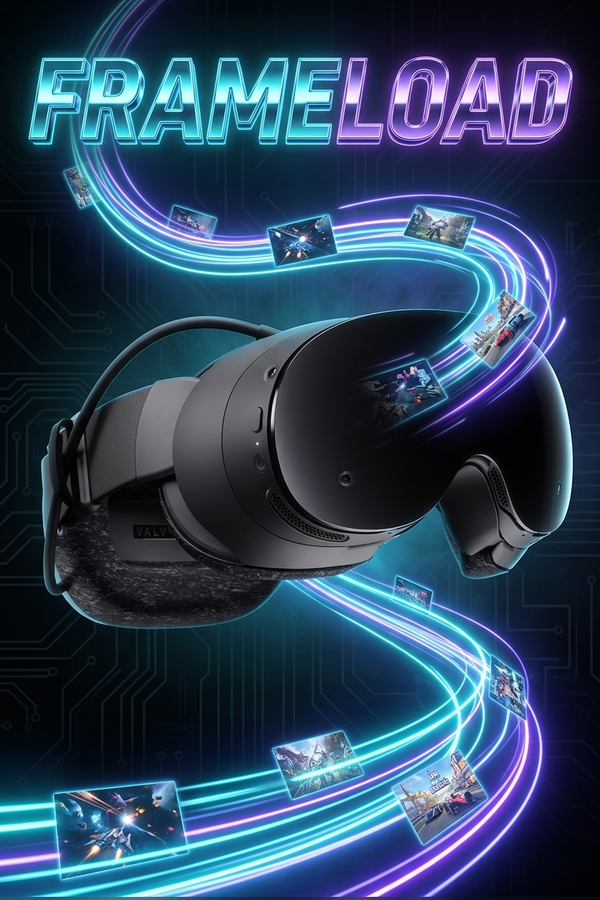 | 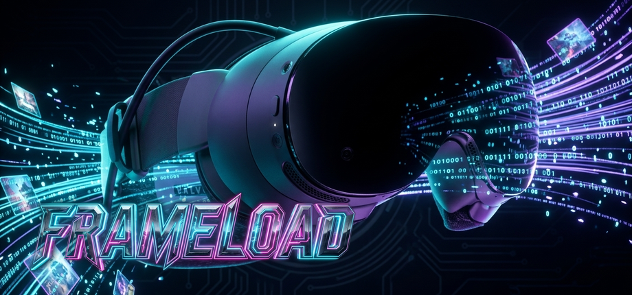 | 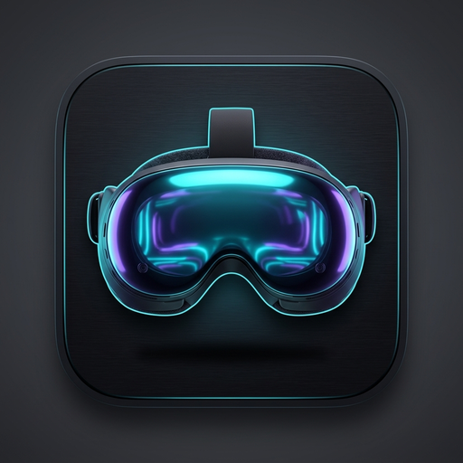 |

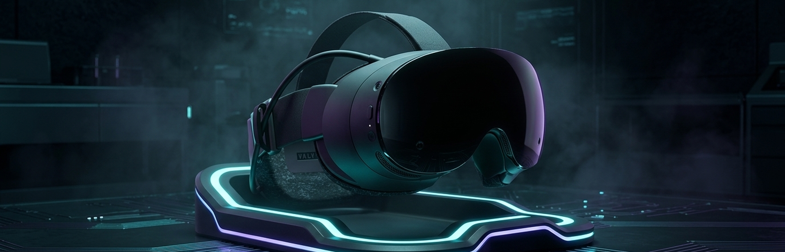

If FrameLoad is missing from your Steam library, **Restart Steam Now** in the dashboard (shown while new games are waiting) adds its shortcut back together with the games'. So does `frameload sync-shortcuts` run while Steam is stopped, or running `bash ~/Applications/FrameLoad/install.sh` again. A FrameLoad tile you renamed or gave other pictures in Steam is left as it is.

---

## ☕ Support the Project

If you love using **FrameLoad** on your Steam Frame and want to support ongoing development, new features, and maintenance, you can support me on Ko-fi:

<p align="left">
  <a href="https://ko-fi.com/K3K314GUP?ref=frameload_readme" target="_blank" rel="noopener noreferrer">
    
  </a>
</p>

[](https://ko-fi.com/K3K314GUP?ref=frameload_readme)

---

## 📜 License

GPL-3.0, see [LICENSE](LICENSE). On-headset porting runs [FramePort](https://github.com/spoopyghosty0/frameport) (GPL-3.0), which FrameLoad downloads by itself; the game folder layout follows FramePort's, so both tools can manage the same library. Not affiliated with Valve or Meta.
